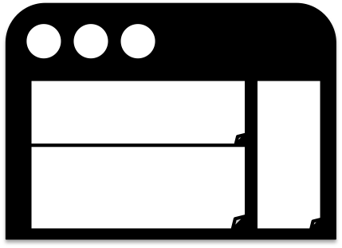

# Tab Finder Browser Extension



A cross-browser extension that allows users to quickly search and navigate through all open tabs. Built with React and Material-UI for a modern, responsive interface.

## Features

- **Quick Tab Search**: Search through all open tabs by title or URL
- **Real-time Filtering**: Instant search results as you type
- **Cross-Browser Support**: Compatible with Firefox, Chrome, and Safari
- **Modern UI**: Built with React and Material-UI components
- **Easy Navigation**: Click on any tab in the search results to switch to it

## Installation

### From Release Files
Download the appropriate extension file from the `release/` directory:
- **Firefox**: `@browser_ext_bh_tab_finder-1.0.3.xpi`
- **Chrome**: Load the extension folder in developer mode

### Development Installation
1. Clone this repository
2. Install dependencies: `npm install`
3. Build the project: `webpack`
4. Load the `TabFinder.safariextension` folder as an unpacked extension

## How to Use

1. Click the Tab Finder icon in your browser toolbar
2. A popup window (640x480px) will appear showing all your open tabs
3. Type in the search field to filter tabs by title or URL
4. Click on any tab in the list to switch to it instantly

## Technical Details

### Architecture
- **Frontend**: React with Material-UI components
- **Build System**: Webpack with Babel for ES6/JSX transpilation
- **Browser APIs**: Uses native tab management APIs for each browser

### Key Components
- `TabFinder`: Main React component handling search logic
- `TabList`: Component for rendering the list of filtered tabs
- Background scripts for browser-specific tab management

### Browser-Specific Implementation
- **Firefox**: Uses Firefox Add-on SDK with panel and button components
- **Chrome**: Uses Chrome Extensions API with browser action popup
- **Safari**: Uses Safari Extensions API (legacy support)

## Project Structure

```
TabFinder.safariextension/
├── manifest.json          # Extension manifest
├── package.json           # Node.js dependencies and project info
├── webpack.config.js      # Webpack build configuration
├── data/
│   ├── popup.html         # Extension popup interface
│   ├── popup.js           # React components for popup
│   ├── background.html    # Background page
│   ├── background.js      # Background script
│   ├── main.js           # Firefox-specific main script
│   ├── popup_release.js   # Built popup script
│   └── background_release.js # Built background script
└── Icon-*.png            # Various icon sizes for different contexts
```

## Development Setup

### Prerequisites
- Node.js and npm
- Browser developer tools enabled

### Build Process
1. **Install dependencies**:
   ```bash
   npm install
   ```

2. **Build the project**:
   ```bash
   webpack
   ```

3. **Development workflow**:
   - Make changes to source files in `data/`
   - Run webpack to build release files
   - Reload the extension in your browser

### Dependencies
- **React**: UI framework
- **Material-UI**: UI components and theming
- **Webpack**: Module bundler
- **Babel**: JavaScript transpiler for ES6/JSX

## Version History

- **v1.0.3**: Latest release with cross-browser support
- **v1.0.2**: Previous stable release
- **v1.0.1**: Initial release

## Browser Compatibility

| Browser | Support | Notes |
|---------|---------|-------|
| Firefox | ✅ | Full support via Add-on SDK |
| Chrome  | ✅ | Full support via Extensions API |
| Safari  | ⚠️ | Legacy support |

## Author

**BH_Lin**

Blog: [Tab Finder Browser Extension](http://studiobinghuan.blogspot.tw/2016/03/tab-finder-browser-extension.html?view=flipcard)
